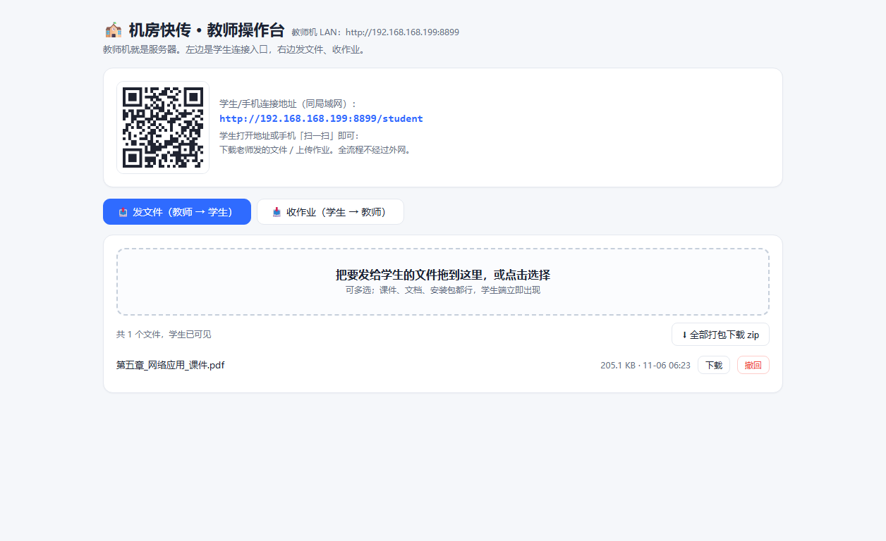
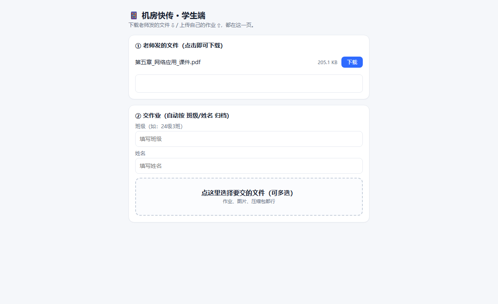
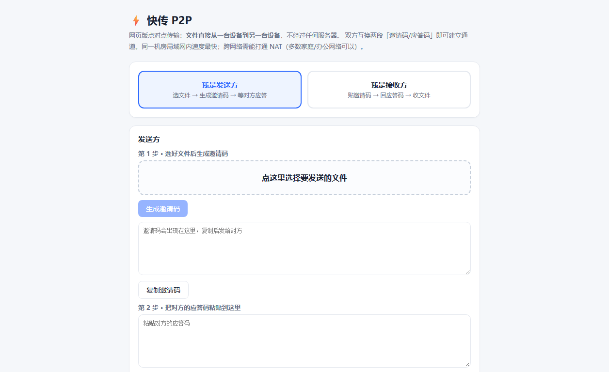

# ⚡ 机房快传

📄 **文档**：[开发手册](docs/DEVELOPMENT.md)（架构 / 数据契约 / 测试 / 二次开发指南）· [更新日志](CHANGELOG.md)

教师机 ↔ 学生机/手机 的文件互传工具，机房场景专用。**三种形态**：

| 形态 | 原理 | 适合场景 | 入口 |
|---|---|---|---|
| **桌面版**（主推） | 教师机起 HTTP 服务，学生扫码/输地址 | 机房发课件、收作业，稳定高速 | `desktop/启动机房快传.bat` 双击 |
| **网页版 P2P** | WebRTC 数据通道，邀请码握手，**无服务器中转** | 临时互传、没有教师机时 | **[GitHub Pages 在线版](https://openclawzhangchong.github.io/jifang-kuaichuan/)**（[备用镜像](https://soulful-nutmeg-mdx6.here.now/)） |

## 界面预览

**桌面版 · 教师操作台**（自动生成局域网二维码，发文件/收作业一键切换）：

**学生端（手机视口）**：

**网页版 P2P**（无服务器点对点，邀请码握手）：

## 桌面版功能

- **发文件**（教师 → 学生）：拖入即全班可见，单个下载或全部打包 zip，可撤回
- **收作业**（学生 → 教师）：学生填班级+姓名上传，自动按 `班级\姓名\` 归档，一键打包 zip
- **二维码接入**：页面自动探测教师机局域网地址并生成二维码，手机扫一扫即用
- 手机连同一 Wi-Fi 也能用
- 全程局域网内传输，不经外网

## 网页版 P2P

- 文件直接从一台设备到另一台设备（WebRTC DTLS 加密数据通道），服务端只提供网页本身
- 邀请码/应答码复制粘贴完成握手（不需要任何账号、信令服务器）
- 同一局域网内直连最快；跨网络需 NAT 可打通（部分对称 NAT 无法直连，届时请用桌面版）

## 隐私与安全边界

- 桌面版按"机房内可信"设计：无登录鉴权，下课关闭黑窗口即停止服务
- 防火墙：`启动机房快传.bat` 会自动添加放行规则 `JifangKuaichuan-8899`（需管理员权限，一般用户已是管理员）
- 仓库不含任何文件数据；传输内容只落在教师机本地文件夹

## 桌面版使用

1. 教师机双击 `desktop/启动机房快传.bat`（需 Python 3.10+）
2. 学生电脑浏览器打开页面显示的地址（形如 `http://192.168.x.x:8899/student`），或手机扫码
3. 发文件 / 交作业，双向都齐了

技术栈：桌面版 Python/Flask + qrcode 服务端二维码；网页版纯前端 WebRTC。

## License

MIT © 2026 智策ZCagent
